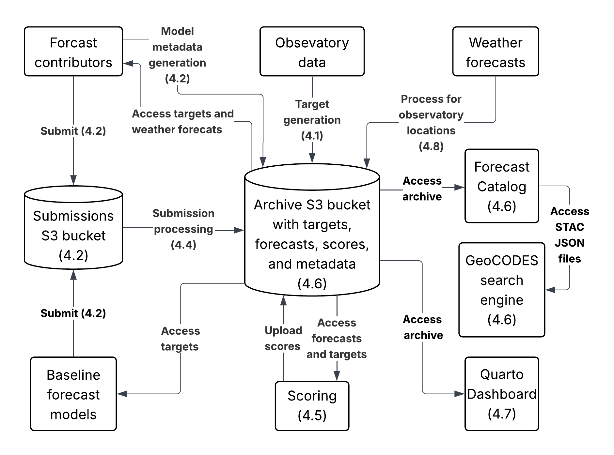

## National Ecological Observatory Network (NEON) Ecological Forecasting Challenge Cyberinfrastructure

Thomas, R.Q. and C. Boettiger. (2025). Cyberinfrastructure to Support Ecological Forecasting Challenges. ESS Open Archive. http://doi.org/10.22541/essoar.175917344.44115142/v1

# 

The following elements of a forecasting challenge workflow are included in this repo. GitHub Actions are used to automate tasks.

1)  Generation of targets
2)  Processing of submissions
3)  Generation of baseline forecasts
4)  Evaluation (scoring) of submitted forecasts
5)  Generation of Quarto dashboard
6)  Generation of STAC catalog
7)  Download of weather drivers for forecasts
8)  Creation of Docker containers with supporting software

Every challenge-specific setting (buckets, endpoints, variables, horizons, sites, catalog text) lives in [`challenge_configuration.yaml`](challenge_configuration.yaml); see [docs/configuration.md](docs/configuration.md) for each key. Code shared between the workflows is a small R package, `challengeci`, in [`R/`](R/); see [docs/developing.md](docs/developing.md) for how to use and change it. [docs/operations.md](docs/operations.md) lists the workflows, their schedules and the secrets they need.

## Quick start

From the repository root, in R (the `eco4cast/rocker-neon4cast` image has every package):

```r
pkgload::load_all()                    # the challengeci package
cfg <- read_config()                   # challenge_configuration.yaml
config_problems(cfg)                   # anything wrong with the config?
devtools::test()                       # unit tests
```

Each stage is a script you can run with `DRY_RUN=true`, which reads the real
(public) buckets but writes only to a local folder:

```sh
DRY_RUN=true Rscript inst/scripts/bundle.R forecasts
DRY_RUN=true Rscript inst/scripts/catalog.R
Rscript inst/scripts/dashboard.R && quarto preview dashboard
```

| Guide | For |
|---|---|
| [docs/configuration.md](docs/configuration.md) | every setting in the config |
| [docs/operations.md](docs/operations.md) | workflows, schedules, secrets, reruns and recovery |
| [docs/developing.md](docs/developing.md) | changing the code |
| [docs/launching-a-new-challenge.md](docs/launching-a-new-challenge.md) | running a new challenge from this repository |

See <[https://doi.org/10.1002/fee.2616](http://doi.org/10.22541/essoar.175917344.44115142/v1)> for more information on the structure of a forecasting challenge.

Supported by the U.S. National Science Foundation grants (DEB-1926388, OAC-2209866, DEB-2327030, and OAC-2311124)
